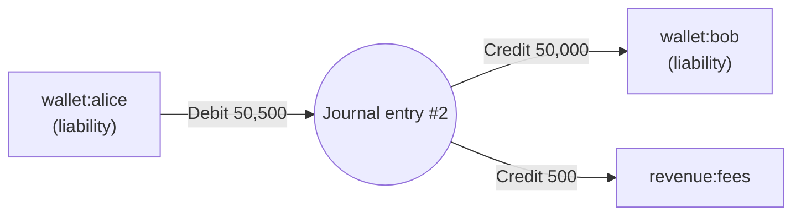

# fintech-ledger-dotnet

**A double-entry ledger for wallets and payments that you can audit, reconcile and trust under concurrency.**

This .NET 10 reference shows the core rules every fintech ledger needs. It's the kind of engine behind
wallet top-ups, P2P transfers, fees, settlement and refunds.

[](../../actions/workflows/ci.yml)


## Invariants

| Rule | How | Test |
|---|---|---|
| Every entry balances (debits = credits) | Validated before commit | `Unbalanced_entry_is_rejected` |
| Money never appears or disappears | The trial balance is always 0 | every scenario |
| Wallets never go negative | Checked against projected balances, all-or-nothing | `Overdraft_is_rejected…`, `Concurrent_transfers…` |
| One currency per entry | FX goes through clearing accounts | `Mixed_currencies…` |
| Posting is idempotent | Unique external reference; the same body replays, a different body is rejected | `Same_reference_twice…` |
| History is immutable | Corrections are reversing entries; each entry can be reversed only once | `Reversal_restores_balances…` |
| Tampering is detectable | SHA-256 hash chain over all entries | `Hash_chain_detects_tampering` |
| Books match the bank | Reconciliation by reference and amount; exceptions go to a human | `ReconciliationTests` |

## A P2P transfer with a fee



```csharp
ledger.Post(new PostRequest("tx-2", "P2P transfer", [
    new Posting("wallet:alice", Direction.Debit, 50_500),
    new Posting("wallet:bob",   Direction.Credit, 50_000),
    new Posting("revenue:fees", Direction.Credit, 500),
]));
```

Amounts are `long` minor units (paisa, cents), never floating point.

## Run

```bash
dotnet test
```

## From reference to production

The in-memory journal keeps the rules readable. [docs/schema.sql](docs/schema.sql) shows how they map to
PostgreSQL:

- unique `external_reference` for idempotency
- `CHECK` constraint against overdrafts
- deferred balance trigger
- `UNIQUE reverses_sequence` so an entry can be reversed only once
- no `UPDATE`/`DELETE` grants on the journal

Also plan for:

- [ ] Serializable isolation or row locks on the affected accounts when posting.
- [ ] Daily reconciliation against bank, PSP and mobile-financial-service statements, with an exceptions queue.
- [ ] Periodically anchor the latest chain hash in a separate system (WORM storage) so tampering can't be hidden by rewriting the chain.
- [ ] Event sourcing or CDC from the journal to reporting. Never report from mutable balance tables alone.
- [ ] Regulatory controls (e.g. Bangladesh Bank MFS guidelines, PCI DSS where card data is involved).

---
Author: [Rubbaite T. Hassain](https://tanvir.info.bd) ([LinkedIn](https://www.linkedin.com/in/rubbaite)) · Software Architect, Founder of [Datazo InfoTech](https://www.datazoinfotech.com.bd) · MIT License
